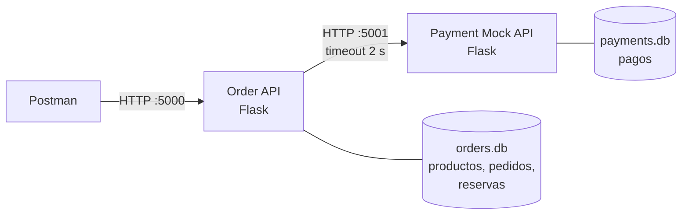

# Reto técnico: pedidos, pagos simulados e idempotencia

API de pedidos que se recupera cuando **un pago se procesa pero su respuesta se pierde**, sin duplicar pedidos, reservas ni cobros.

Asignatura: **Sistemas Distribuidos**, séptimo semestre.

## Integrantes

| Integrante | Usuario de GitHub |
|---|---|
| Jose Ponce Carlos | [@Joseepc18](https://github.com/Joseepc18) |
| Luis Anchundia Cruz | [@LuisAnchundia](https://github.com/LuisAnchundia) |
| Dayron Quiñonez Valencia | [@DayronQV](https://github.com/DayronQV) |

## De qué se trata

Una tienda recibe una solicitud para crear un pedido y reservar inventario. El pedido se registra y el servicio de pago alcanza a **registrar el cobro**, pero **la respuesta del pago se pierde**. El backend no sabe si debe reintentar, consultar el estado o cancelar la reserva; si repite la operación a ciegas podría **cobrar dos veces** o **reservar dos veces**.

Para resolverlo construimos dos servicios Flask, cada uno con su propia base SQLite:

- **Order API**: crea pedidos, controla el inventario, inicia el pago y expone el estado.
- **Payment Mock API**: simula un pago aprobado, uno rechazado y un **timeout después de registrar el cobro**. No procesa tarjetas ni dinero real.

Y aplicamos cuatro ideas:

| Idea | Cómo la aplicamos |
|---|---|
| **Idempotencia** | Cada pedido llega con un header `Idempotency-Key` guardado con restricción `UNIQUE`. Misma clave = mismo intento: se devuelve el resultado conocido sin crear otra reserva ni otro cobro. Clave distinta = otra intención de compra |
| **Recuperación** | Si la respuesta del pago se pierde, el pedido queda en `PAGO_INCIERTO` y se **consulta** el pago en el mock por su `payment_key`. Nunca se vuelve a cobrar a ciegas |
| **Compensación** | Si el pago se rechaza después de reservar, la reserva se **libera una sola vez** y el pedido queda `RECHAZADO` |
| **Persistencia** | Todos los estados viven en SQLite, así que se pueden consultar y recuperar incluso después de reiniciar los servicios |

## Arquitectura



Postman habla solo con la Order API (y con el mock para consultar evidencia). La Order API llama al mock con un tiempo límite de 2 s. En el modo `timeout`, el mock guarda el cobro y tarda 5 s en responder, así la respuesta "se pierde".

## Herramientas

| Herramienta | Uso |
|---|---|
| Python 3.10 o superior | Lenguaje de ambos servicios |
| Flask 3.1 | Framework web de las dos APIs |
| requests 2.34 | Llamadas HTTP de la Order API al mock, con tiempo límite |
| SQLite (`sqlite3` de Python) | Persistencia de cada servicio; no hay que instalar nada |
| Postman | Colección con los 5 casos de prueba |
| Git y GitHub | Código, issues y pull requests del equipo |

## Estructura del proyecto

```
reto-pedidos-pagos-idempotenci/
├── order_api/
│   ├── app.py              # Rutas Flask de la Order API (puerto 5000)
│   ├── db.py               # Conexión SQLite y creación de tablas
│   ├── schema.sql          # Tablas: productos, pedidos, reservas
│   └── payment_client.py   # Llamadas HTTP al Payment Mock (con timeout)
├── payment_mock/
│   ├── app.py              # Rutas Flask del Payment Mock (puerto 5001)
│   ├── db.py               # Conexión SQLite y creación de la tabla
│   └── schema.sql          # Tabla: pagos
├── postman/
│   └── reto-pedidos-pagos.postman_collection.json   # Colección de Postman (v2.1)
├── scripts/
│   └── evidencia.py        # Informe de evidencia sobre las dos bases SQLite
├── docs/
│   ├── estados.md          # Estados del pedido, la reserva y el pago
│   └── contrato-api.md     # Endpoints, cuerpos y respuestas
├── AGENTS.md               # Contexto y reglas para agentes de IA
├── CLAUDE.md               # Apunta a AGENTS.md (Claude Code)
├── requirements.txt
└── README.md
```

Las bases `order_api/orders.db` y `payment_mock/payments.db` se crean solas al arrancar cada servicio y no se suben al repositorio.

## Estados

| Pedido | Significado |
|---|---|
| `PENDIENTE_PAGO` | Creado y con stock reservado; esperando el pago |
| `PAGO_INCIERTO` | La respuesta del pago se perdió; hay que consultar al mock |
| `PAGADO` | Pago aprobado, reserva confirmada (final) |
| `RECHAZADO` | Pago rechazado, reserva liberada (final) |
| `SIN_STOCK` | No había inventario; sin reserva ni cobro (final) |

Reservas: `RESERVADA`, `CONFIRMADA`, `LIBERADA`. Pagos: `APROBADO`, `RECHAZADO`.
Detalle y transiciones en [docs/estados.md](docs/estados.md).

## Instalación

Clonar el repositorio y crear un entorno virtual:

```bash
git clone https://github.com/DayronQV/reto-pedidos-pagos-idempotenci.git
cd reto-pedidos-pagos-idempotenci
python -m venv .venv
```

Instalar las dependencias.

Windows (PowerShell):
```powershell
.venv\Scripts\python -m pip install -r requirements.txt
```

Linux / macOS:
```bash
.venv/bin/python -m pip install -r requirements.txt
```

## Ejecución

Cada servicio se levanta en **su propia terminal**, desde la raíz del repositorio.

**Terminal 1: Payment Mock API** (puerto 5001)

Windows:
```powershell
.venv\Scripts\python payment_mock\app.py
```

Linux / macOS:
```bash
.venv/bin/python payment_mock/app.py
```

**Terminal 2: Order API** (puerto 5000)

Windows:
```powershell
.venv\Scripts\python order_api\app.py
```

Linux / macOS:
```bash
.venv/bin/python order_api/app.py
```

**Comprobar que ambos responden:**

Windows (PowerShell; allí `curl` es un alias de otro comando, por eso se usa `curl.exe`):
```powershell
curl.exe http://127.0.0.1:5001/health
```

```powershell
curl.exe http://127.0.0.1:5000/health
```

Linux / macOS:
```bash
curl http://127.0.0.1:5001/health
```

```bash
curl http://127.0.0.1:5000/health
```

Cada uno debe responder `{"status": "ok", ...}`.

### Variables de entorno (opcionales)

| Variable | Por defecto | Para qué |
|---|---|---|
| `ORDER_API_PORT` | `5000` | Puerto de la Order API |
| `PAYMENT_API_URL` | `http://127.0.0.1:5001` | Dónde encuentra la Order API al mock |
| `PAYMENT_TIMEOUT_SECONDS` | `2` | Cuánto espera la Order API la respuesta del pago |
| `PAYMENT_MOCK_PORT` | `5001` | Puerto del Payment Mock |
| `MOCK_TIMEOUT_DELAY_SECONDS` | `5` | Cuánto tarda el mock en responder en el modo `timeout` |

Ejemplo en PowerShell: `$env:ORDER_API_PORT = "5050"` antes de arrancar el servicio. En macOS el puerto 5000 puede estar ocupado por AirPlay; en ese caso usar otro puerto.

## Endpoints

| Servicio | Método y ruta | Para qué |
|---|---|---|
| Ambos | `GET /health` | Comprobar que el servicio está arriba |
| Order API | `GET /products` | Ver inventario |
| Order API | `POST /orders` | Crear pedido (header `Idempotency-Key`) |
| Order API | `GET /orders`, `GET /orders/<id>` | Consultar pedidos |
| Order API | `POST /orders/<id>/reconciliar` | Recuperar un pedido con pago incierto |
| Order API | `POST /admin/reset` | Reiniciar datos de prueba |
| Payment Mock | `POST /payments` | Registrar pago (`aprobado`, `rechazado` o `timeout`) |
| Payment Mock | `GET /payments`, `GET /payments/<payment_key>` | Consultar pagos |
| Payment Mock | `POST /admin/reset` | Borrar pagos de prueba |

Cuerpos, respuestas y códigos HTTP en [docs/contrato-api.md](docs/contrato-api.md).

## Casos de prueba (Postman)

| Caso | Qué se hace | Qué se demuestra |
|---|---|---|
| 1. Flujo exitoso | Pedido con pago aprobado | 1 pedido, 1 reserva, 1 cobro y estado `PAGADO` |
| 2. Repetición de la misma solicitud | Reenviar con la misma `Idempotency-Key` | No se duplica pedido, reserva ni cobro |
| 3. Respuesta perdida después del cobro | El mock registra el cobro y simula timeout; se reintenta con la misma clave | Se resuelve consultando el pago, sin cobrar otra vez |
| 4. Pago rechazado | Forzar el rechazo | Pedido `RECHAZADO` y reserva liberada una sola vez |
| 5. Otra intención de compra | Otra clave cuando queda una unidad | Se trata como operación distinta y el stock nunca queda negativo |

## Colección de Postman

La colección está en `postman/reto-pedidos-pagos.postman_collection.json` (formato v2.1).

1. Dejar **ambos servicios encendidos** (sección [Ejecución](#ejecución)).
2. En Postman: **Import** y elegir el archivo anterior. Aparece la colección **Reto Pedidos Pagos Idempotencia** con las variables `order_url` (`http://127.0.0.1:5000`) y `payment_url` (`http://127.0.0.1:5001`). Si se cambió algún puerto, editarlas en la pestaña **Variables** de la colección.
3. Clic derecho sobre la colección, **Run collection** y **Run** (Collection Runner).

Se ejecutan las carpetas en orden: la **0** reinicia ambos servicios y deja el inventario inicial (producto 1 con stock 10 y producto 2 con stock 1); las **1 a 5** son los casos de la tabla anterior. Cada petición tiene pruebas (`pm.test`) sobre el código HTTP y el estado. Al terminar deben salir **24 peticiones y 25 verificaciones, todas en verde**. La carpeta 3 tarda unos 2 s porque simula el timeout.

Las claves `Idempotency-Key` se generan solas en cada corrida, y la carpeta 0 reinicia los datos, así que la colección se puede ejecutar varias veces seguidas.

## Reiniciar los datos y ver las bases

**Reiniciar los datos de prueba** (borra pedidos, reservas y pagos, y devuelve el stock a 10 y 1), con ambos servicios encendidos:

Linux / macOS:
```bash
curl -X POST http://127.0.0.1:5000/admin/reset
```

```bash
curl -X POST http://127.0.0.1:5001/admin/reset
```

Windows (PowerShell):
```powershell
curl.exe -X POST http://127.0.0.1:5000/admin/reset
```

```powershell
curl.exe -X POST http://127.0.0.1:5001/admin/reset
```

Para empezar de cero del todo, apagar los servicios y borrar `order_api/orders.db` y `payment_mock/payments.db`; se crean de nuevo al arrancar.

**Ver lo que quedó guardado**, desde la raíz del repositorio (con los servicios encendidos o apagados):

Windows:
```powershell
.venv\Scripts\python scripts\evidencia.py
```

Linux / macOS:
```bash
.venv/bin/python scripts/evidencia.py
```

El script usa solo `sqlite3` de Python, abre las bases en modo lectura e imprime:

- el total de pedidos, reservas y pagos, y cuántos hay en cada estado;
- el stock actual de cada producto;
- las `Idempotency-Key` y `payment_key` repetidas, que **debe salir vacío**;
- el cruce de cada pedido con su pago por `payment_key` (cada pedido con cobro tiene exactamente 1 pago, y su estado coincide con el del pago: `PAGADO` con `APROBADO` y `RECHAZADO` con `RECHAZADO`) y la coherencia entre el estado del pedido y el de su reserva.

Termina con `RESULTADO: correcto` (código de salida 0) o con `RESULTADO: revisar` (código 1) si encuentra algo.

## Prueba de reinicio

Demuestra que los estados viven en SQLite y no en memoria: se deja un pedido en `PAGO_INCIERTO`, se apagan y encienden ambos servicios, y el pedido sigue consultable y se puede recuperar.

1. Con ambos servicios encendidos, reiniciar los datos (sección anterior) y crear un pedido con timeout. Responde **202** con `PAGO_INCIERTO`:

   Linux / macOS:
   ```bash
   curl -X POST http://127.0.0.1:5000/orders -H "Content-Type: application/json" -H "Idempotency-Key: reinicio-1" -d '{"producto_id": 1, "cantidad": 1, "simular_pago": "timeout"}'
   ```

   Windows (PowerShell):
   ```powershell
   Invoke-RestMethod -Method Post -Uri http://127.0.0.1:5000/orders -Headers @{"Idempotency-Key" = "reinicio-1"} -ContentType "application/json" -Body '{"producto_id": 1, "cantidad": 1, "simular_pago": "timeout"}'
   ```

2. **Apagar** ambos servicios (`Ctrl+C` en cada terminal) y **volver a encenderlos** con los comandos de la sección Ejecución.
3. Comprobar que los estados siguen ahí: `GET http://127.0.0.1:5000/orders/1` sigue en `PAGO_INCIERTO` y `GET http://127.0.0.1:5001/payments/PAY-reinicio-1` muestra el cobro `APROBADO`.
4. Recuperar el pedido consultando al mock (sin cobrar otra vez): `POST http://127.0.0.1:5000/orders/1/reconciliar` devuelve el pedido `PAGADO`. También se recupera reenviando el `POST /orders` con la misma `Idempotency-Key`.
5. Ejecutar `scripts/evidencia.py`: hay 1 pedido `PAGADO`, 1 reserva `CONFIRMADA` y **1 solo pago** con `PAY-reinicio-1`.
