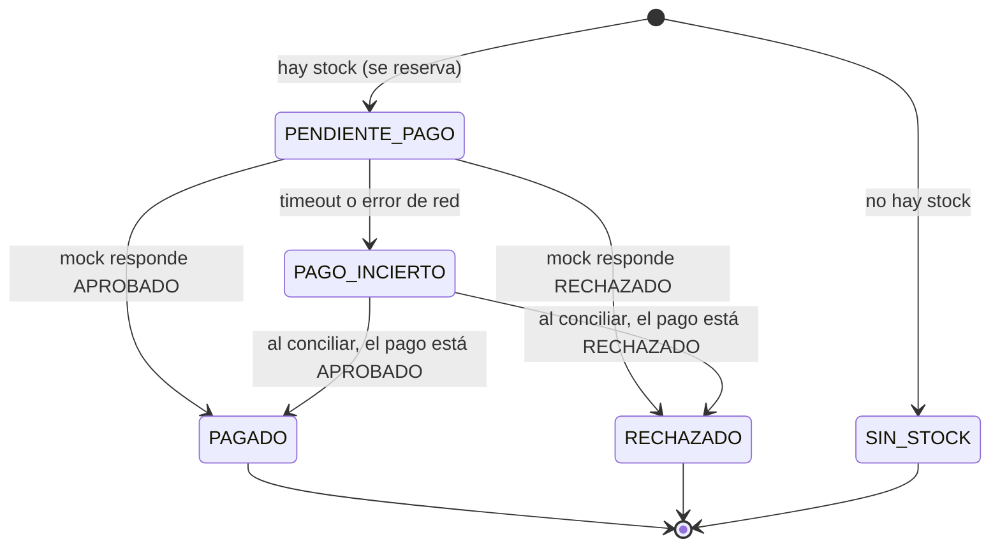

# Estados del sistema

Este documento define los estados que guardan las dos bases SQLite y cómo se pasa de uno a otro. Todo el código debe usar **exactamente** estos valores (en mayúsculas).

## Estados del pedido (`pedidos.estado` en la Order API)

| Estado | Significado | ¿Final? |
|---|---|---|
| `PENDIENTE_PAGO` | Pedido creado y stock reservado; todavía no hay respuesta del pago | No |
| `PAGO_INCIERTO` | Se llamó al pago pero la respuesta se perdió (timeout o error de red). No sabemos si se cobró | No |
| `PAGADO` | Pago aprobado y reserva confirmada | Sí |
| `RECHAZADO` | Pago rechazado y reserva liberada (stock devuelto) | Sí |
| `SIN_STOCK` | No había inventario; no se creó reserva ni cobro | Sí |

### Transiciones permitidas

| Desde | Hacia | Cuándo |
|---|---|---|
| *(nuevo)* | `PENDIENTE_PAGO` | Se descontó el stock y se creó la reserva |
| *(nuevo)* | `SIN_STOCK` | El `UPDATE` de stock no encontró unidades suficientes |
| `PENDIENTE_PAGO` | `PAGADO` | El mock respondió `APROBADO` |
| `PENDIENTE_PAGO` | `RECHAZADO` | El mock respondió `RECHAZADO` (se aplica la compensación) |
| `PENDIENTE_PAGO` | `PAGO_INCIERTO` | La llamada al mock dio timeout o error de conexión |
| `PAGO_INCIERTO` | `PAGADO` | Al conciliar, `GET /payments/<payment_key>` devuelve `APROBADO` |
| `PAGO_INCIERTO` | `RECHAZADO` | Al conciliar, `GET /payments/<payment_key>` devuelve `RECHAZADO` |

Reglas:
- Un estado final (`PAGADO`, `RECHAZADO`, `SIN_STOCK`) **no cambia nunca**.
- De `PAGO_INCIERTO` solo se sale **consultando** al mock, nunca cobrando de nuevo a ciegas.
- Si al conciliar el mock responde **404** (el cobro nunca se registró), se puede reenviar `POST /payments` con **la misma** `payment_key`; el mock no la duplica.

## Estados de la reserva (`reservas.estado` en la Order API)

| Estado | Significado |
|---|---|
| `RESERVADA` | Se descontó el stock para el pedido; el pago todavía no está resuelto |
| `CONFIRMADA` | El pago fue aprobado; la unidad queda vendida |
| `LIBERADA` | El pago fue rechazado; el stock se devolvió **una sola vez** |

Transiciones: `RESERVADA → CONFIRMADA` o `RESERVADA → LIBERADA`. Para liberar se usa `... WHERE estado = 'RESERVADA'`, así una segunda liberación no encuentra filas y no devuelve stock otra vez.

## Estados del pago (`pagos.estado` en el Payment Mock)

| Estado | Significado |
|---|---|
| `APROBADO` | El cobro quedó registrado (también en el modo `timeout`, que guarda el cobro antes de demorar la respuesta) |
| `RECHAZADO` | El pago fue rechazado; no hubo cobro |

Un pago no cambia de estado después de guardarse. La `payment_key` es única: repetirla devuelve el pago existente.

## Claves

| Clave | Dónde | Quién la genera | Para qué |
|---|---|---|---|
| `Idempotency-Key` | Header de `POST /orders`; columna `pedidos.idempotency_key` (UNIQUE) | El cliente (Postman) | Identifica una **intención de compra**. Misma clave = mismo intento |
| `payment_key` | `pedidos.payment_key` (UNIQUE) y `pagos.payment_key` (UNIQUE) | La Order API: `"PAY-" + Idempotency-Key` | Identifica **el cobro** de ese pedido. Nunca se genera una nueva para un pedido existente |
